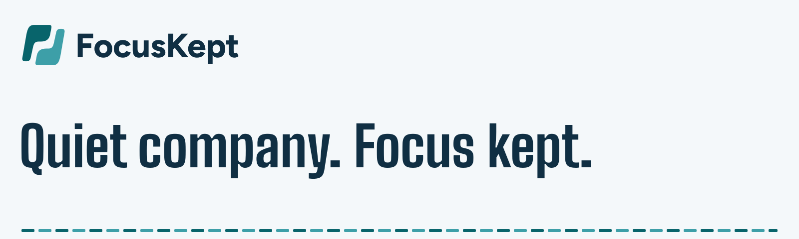
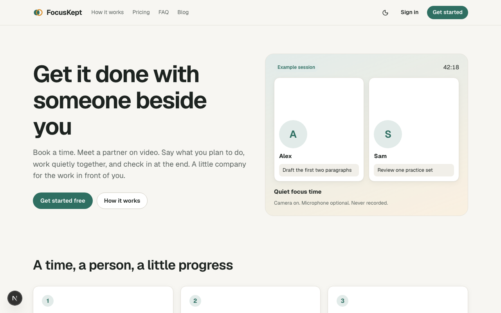
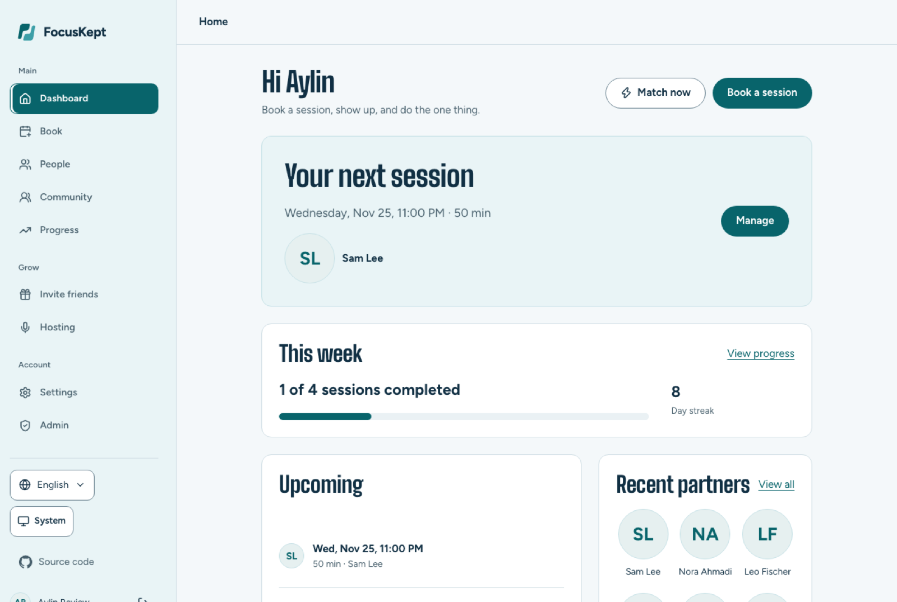

<picture>
  <source media="(prefers-color-scheme: dark)" srcset="brand/exports/repository/readme-banner-dark.png">
  
</picture>

# FocusKept

**Get it done with someone beside you.**

FocusKept is a body doubling app. Book a time, meet a partner on video, say what you'll work on, then focus quietly together. Sessions are 25, 50 or 75 minutes, and video is never recorded.

[**Try it at focuskept.com →**](https://focuskept.com) · free during early access



| Your dashboard                               | Booking a session                                  |
| -------------------------------------------- | -------------------------------------------------- |
|  |  |

## What it does

- **Book or match now.** Pick a time, or get paired with whoever is free right now.
- **A partner, not a feed.** One person on camera, one shared goal, a quiet timer.
- **Community.** Share what you're working on and cheer each other on.
- **Yours to run.** Open source, self-hostable, in five languages.

## Run it yourself

You need Node 24, pnpm and Docker.

```sh
pnpm install
pnpm setup          # asks a few questions
pnpm local:up
pnpm local:migrate
```

Then open http://localhost:3000. For a real server, see [docs/SELF_HOSTING.md](docs/SELF_HOSTING.md).

## Built with

Next.js · PostgreSQL · Drizzle · Better Auth · Cloudflare Realtime

## About

Made by [Murad Gojayev](https://github.com/gojayevmurad).
Ideas and bug reports are welcome in [issues](https://github.com/gojayevmurad/focuskept/issues). See [CONTRIBUTING.md](CONTRIBUTING.md) before opening a pull request.

Licensed under [AGPL-3.0](LICENSE).
