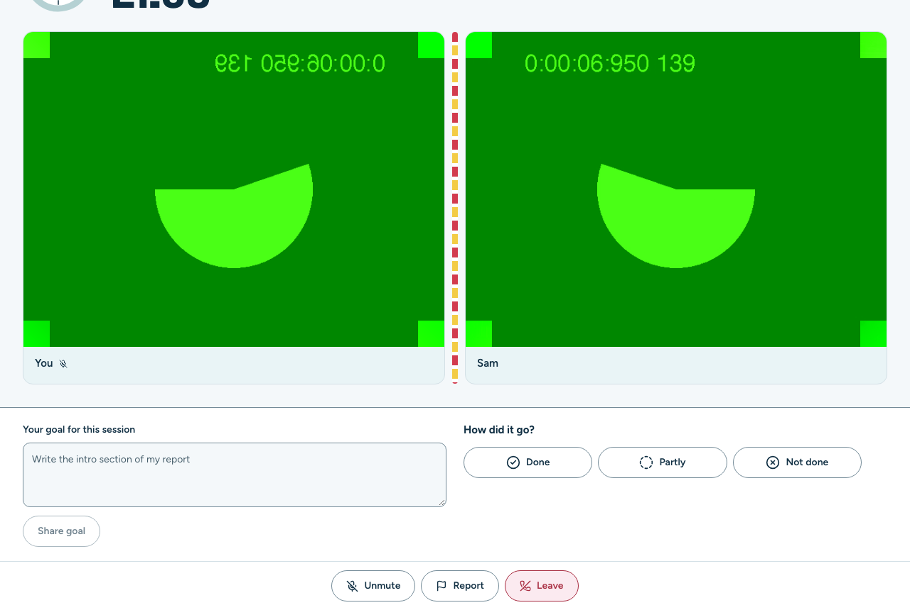

<picture>
  <source media="(prefers-color-scheme: dark)" srcset="brand/exports/repository/readme-banner-dark.png">
  
</picture>

# FocusKept

FocusKept is an open-source virtual coworking and body doubling app. Book a time, get paired with a partner, say your goal, work on camera, and report back at the end. Sessions last 25, 50, or 75 minutes. Video is never recorded. The product name comes from configuration and defaults to FocusKept.

Use the hosted version at [focuskept.com](https://focuskept.com) or run your own copy with Docker Compose.

## Features

- Scheduled partner matching and hosted group sessions.
- Session goals, outcomes, reminders, and personal booking links.
- Favorites, partner preferences, blocks, and reports.
- Email/password accounts and optional Google sign-in.
- Optional Polar billing, with billing disabled for self-hosting if desired.
- Configurable branding, signup access, video provider, and localization.

## Screenshots

| Landing page                               | Booking calendar                                          | Session room                                          |
| ------------------------------------------ | --------------------------------------------------------- | ----------------------------------------------------- |
|  |  |  |

The room screenshot uses the browser's test camera.

## Hosted version

[focuskept.com](https://focuskept.com) runs the latest `main`. It is free during early access.

## Self-hosting quick start

Use Node 24, pnpm 11, and Docker Compose. Setup generates the environment files and project-specific credentials:

```sh
pnpm install
pnpm setup -- --name "My Coworking" --slug my-coworking --domain coworking.example.com --repository yourname/yourrepo
docker compose --env-file .env.local up
```

In another terminal, run `pnpm local:migrate` to apply migrations. See [SELF_HOSTING.md](SELF_HOSTING.md) for deployment and video configuration.

## Running in production with Docker Compose

The app and the background worker run from one image next to PostgreSQL. `deploy/compose.production.yaml` defines all three services and expects an HTTPS reverse proxy (the examples use Caddy) on an external Docker network named `proxy`.

```sh
# On your machine: generate the deployment bundle and build an image for the server's architecture
pnpm setup -- --name "My Coworking" --slug my-coworking --domain coworking.example.com --repository yourname/yourrepo
docker build --platform linux/arm64 -t local/my-coworking:$(git rev-parse HEAD) .

# On the server, inside the copied deploy directory
bash configure-runtime.sh https://coworking.example.com local/my-coworking:<commit>   # fills runtime.env once
docker compose --env-file .env -f compose.production.yaml run --rm --no-deps app node scripts/migrate.cjs
bash deploy.sh local/my-coworking:<commit>                                           # health-checked, rolls back on failure
```

You need a domain, a [Resend](https://resend.com) account with a verified sender for sign-in emails, and a video provider (Cloudflare Realtime or self-hosted LiveKit). Billing is optional: with `BILLING_ENABLED=false` everyone gets unlimited sessions. [SELF_HOSTING.md](SELF_HOSTING.md) and [DEPLOY.md](DEPLOY.md) cover every setting, backups and video setup.

## Development

After installation and setup:

```sh
pnpm local:up
pnpm local:migrate
pnpm worker
```

The worker runs in its own terminal. `local:up` starts the app and PostgreSQL in Docker. To run Next.js on the host, stop the Docker app with `docker compose --env-file .env.local stop app`, then run `pnpm dev` in another terminal.

Run checks and tests with:

```sh
pnpm spdx:check
pnpm typecheck
pnpm lint
pnpm test
pnpm local:test-db
pnpm test:integration
pnpm exec playwright install chromium
pnpm test:e2e
```

Integration and browser tests use an isolated database whose name ends in `_test`. Stop the app using port 3000 before browser tests; Playwright starts its own server.

## Tech stack

- Next.js 16, React, and TypeScript.
- PostgreSQL and Drizzle ORM.
- Better Auth and Polar.
- pg-boss background worker.
- Cloudflare Realtime or LiveKit for video.
- next-intl for localization.

## Branding

Self-hosted deployments set their own name and logo at runtime with `APP_NAME`, `LOGO_URL`, and `SUPPORT_EMAIL`, and their colors in `src/config/brand.css`; see [SELF_HOSTING.md](SELF_HOSTING.md#branding). The same image works for any identity: with a custom name, emails and share images show that name as text instead of the FocusKept wordmark.

The FocusKept identity (**Side by Side**) lives in [`brand/`](brand/README.md): logo and icon downloads (SVG, PNG, PDF), social and repository images, tokens, and the [usage guide](docs/brand/usage.md). `pnpm brand:generate` rebuilds every asset from one geometry and token source, and `pnpm brand:check` verifies them. The artwork is covered by this repository's license; Figtree and Big Shoulders are separate font software under the SIL Open Font License 1.1 ([notices](brand/fonts/README.md)).

## Contributing

See [CONTRIBUTING.md](CONTRIBUTING.md) for setup, checks, and pull requests.

## Security

Please report vulnerabilities privately as described in [SECURITY.md](SECURITY.md).

## License

FocusKept is licensed under [AGPL-3.0-only](LICENSE). You may use, change and host it. If you run a modified version as a service for other people, you must offer them the source code of your version under the same license.
