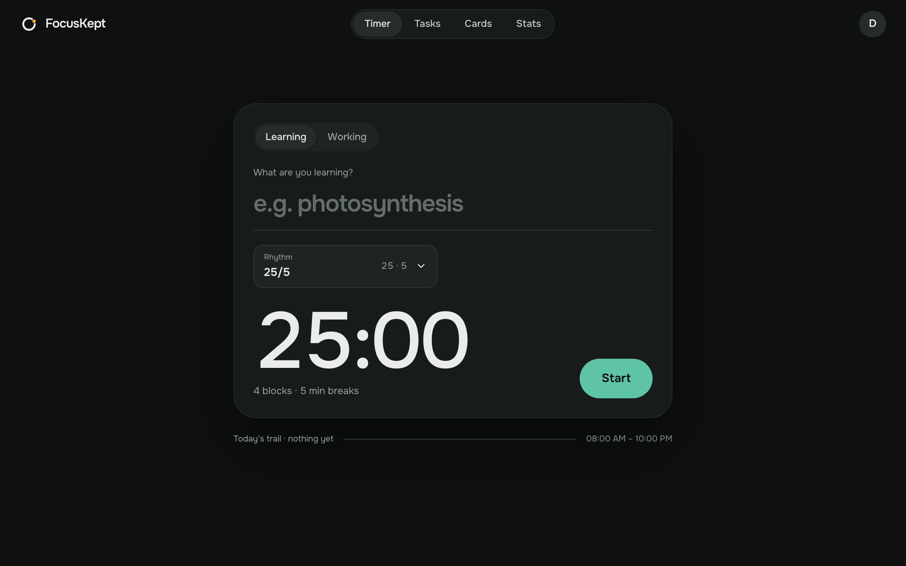
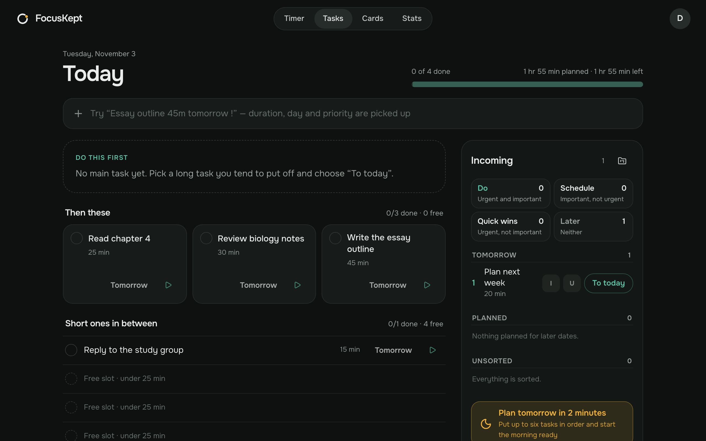
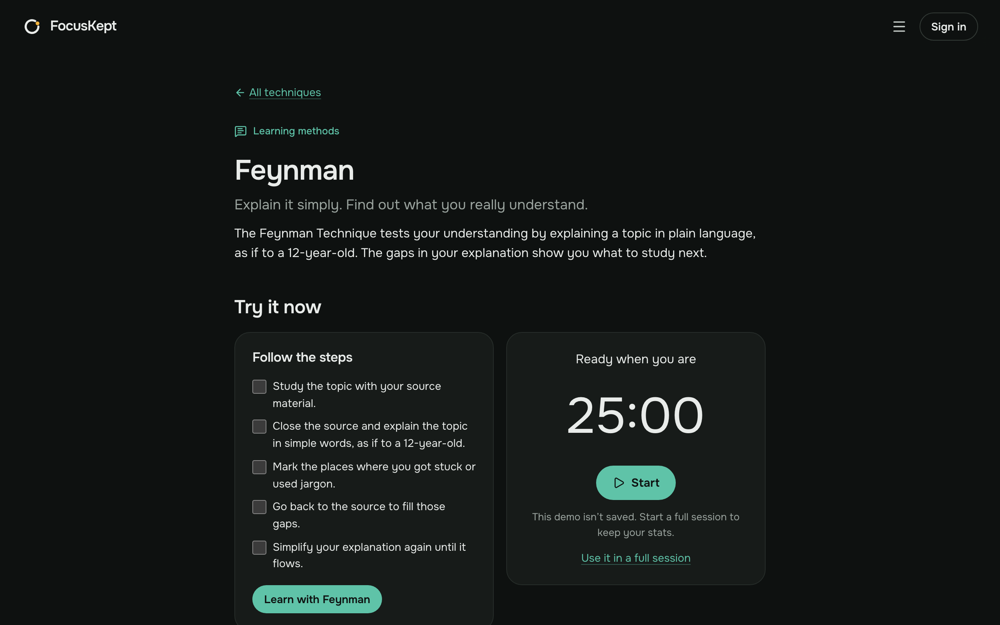

# FocusKept

A focus timer that also helps you remember what you studied.

Most timers forget everything when the session ends, and flashcard apps make you write every card by hand. FocusKept connects the two: you focus, explain the topic in your own words, and get review questions on day 5, 10 and 30.

**Try it:** [focuskept.com](https://focuskept.com). The timer works without an account.



| Day board                            | Technique guide                      |
| ------------------------------------ | ------------------------------------ |
|  |  |

## Features

- **Timer:** 25/5, 52/17, Flowtime, Deep Work 90, timeboxing or custom. Without an account, sessions stay on your device until you sign up.
- **Learning:** explain a topic, then get AI feedback and editable questions, or write your own.
- **Reviews:** cards come back on a spaced schedule. Open answers are graded by AI, with self-grading as a fallback.
- **Tasks:** a one-page day board with frog of the day, 1-3-5, Eisenhower and Ivy Lee.
- **Stats:** streaks, weekly goal, retention, and which technique works best for you.
- **Reminders:** daily digest email, web push and a weekly report.
- **24 languages,** including right-to-left, and installable as a PWA.

## Stack

Next.js 16, PostgreSQL with Drizzle, Better Auth, next-intl, Polar for billing, Resend for email, OpenAI for AI features.

## Getting started

You need Node 24, Docker, and pnpm through Corepack.

```sh
git clone https://github.com/gojayevmurad/focuskept.git
cd focuskept
corepack enable
pnpm install --frozen-lockfile
pnpm setup
pnpm local:up
pnpm local:migrate
pnpm dev:seed
```

Open <http://localhost:7515> and sign in with `dev@focuskept.test`. The password is in `scripts/dev-seed.mjs`.

- `pnpm setup` creates `.env.local` with random local secrets from `.env.example`. It never overwrites an existing file.
- `pnpm local:up` starts the app, PostgreSQL and the job scheduler in Docker. The ports are in `saas.config.json`.
- `pnpm local:logs` shows app logs, and `pnpm local:stop` stops everything and keeps your data.

If styles look stale in the dev server, clear its cache and restart it:

```sh
docker exec focuskept-dev-app-1 rm -rf /app/.next/dev /app/.next/cache
docker restart focuskept-dev-app-1
```

## External services

The app runs with no external accounts. Add a key to `.env.local` and restart to turn a service on.

| Service         | Variables                                  | Without it                                           |
| --------------- | ------------------------------------------ | ---------------------------------------------------- |
| OpenAI          | `OPENAI_API_KEY`                           | Write questions by hand and grade answers yourself   |
| Resend          | `RESEND_API_KEY`, `EMAIL_MODE=send`        | Emails stay local; read them with `pnpm email:inbox` |
| Polar           | `POLAR_*`                                  | No checkout; billing stays off                       |
| Google          | `GOOGLE_CLIENT_ID`, `GOOGLE_CLIENT_SECRET` | Email and password sign-in only                      |
| Web push        | `VAPID_*`                                  | No push notifications                                |
| PostHog, Sentry | `NEXT_PUBLIC_POSTHOG_KEY`, `SENTRY_DSN`    | No analytics or error reports                        |

For Google sign-in, add `<APP_URL>/api/auth/callback/google` as a redirect URI on your OAuth client. All variables are listed in `.env.example`.

## Database

```sh
pnpm local:migrate   # apply migrations
pnpm dev:seed        # create the local test account
pnpm db:generate     # generate a migration after changing src/lib/db/schema.ts
```

To start over with an empty database, run `docker compose --env-file .env.local down -v`, then repeat `pnpm local:up` and `pnpm local:migrate`.

## Tests and build

Integration and end-to-end tests need their own database, so start it first:

```sh
pnpm local:test-db
```

| Command                 | What it does              |
| ----------------------- | ------------------------- |
| `pnpm test`             | Unit tests                |
| `pnpm test:integration` | Integration tests         |
| `pnpm test:e2e`         | Playwright tests          |
| `pnpm lint`             | ESLint                    |
| `pnpm typecheck`        | TypeScript                |
| `pnpm i18n:check`       | Validate all locale files |
| `pnpm build`            | Production build          |

`pnpm test:e2e` needs a browser the first time: `pnpm exec playwright install chromium`.

## Known limitations

- The release workflow builds ARM64 images only.
- Translations were not all reviewed by native speakers. Corrections are welcome.
- The legal pages in `content/legal/` describe focuskept.com. Replace them if you run your own copy.

## Self-hosting

See [DEPLOYMENT.md](DEPLOYMENT.md). How the code fits together is in [ARCHITECTURE.md](ARCHITECTURE.md).

## Contributing

See [CONTRIBUTING.md](CONTRIBUTING.md). To report a vulnerability, see [SECURITY.md](SECURITY.md).

## License

[MIT](LICENSE). The license covers the code. The FocusKept name and logo are not licensed for use by other products or services. See also the [third-party notices](THIRD_PARTY_NOTICES.md).
