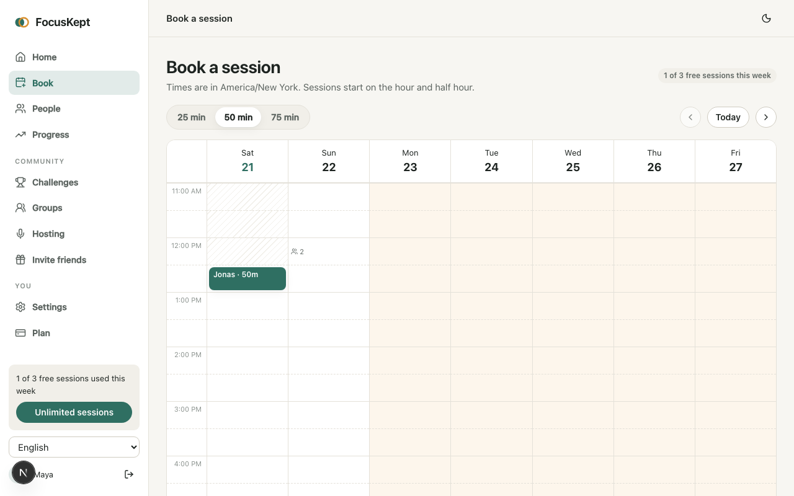

# FocusKept

FocusKept is an open-source virtual coworking and body doubling app. Book a time, get paired with a partner, say your goal, work on camera, and report back at the end. Sessions last 25, 50, or 75 minutes. Video is never recorded. The product name comes from configuration and defaults to FocusKept.

## Features

- Scheduled partner matching and hosted group sessions.
- Session goals, outcomes, reminders, and personal booking links.
- Favorites, partner preferences, blocks, and reports.
- Email/password accounts and optional Google sign-in.
- Optional Polar billing, with billing disabled for self-hosting if desired.
- Configurable branding, signup access, video provider, and localization.

## Screenshots

| Landing page | Booking calendar | Session room |
| --- | --- | --- |
|  |  |  |

The room screenshot uses the browser's test camera.

## Hosted version

Use [focuskept.com](https://focuskept.com).

## Self-hosting quick start

Use Node 24, pnpm 11, and Docker Compose. Setup generates the environment files and project-specific credentials:

```sh
pnpm install
pnpm setup -- --name "My Coworking" --slug my-coworking --domain coworking.example.com --repository yourname/yourrepo
docker compose --env-file .env.local up
```

In another terminal, run `pnpm local:migrate` to apply migrations. See [SELF_HOSTING.md](SELF_HOSTING.md) for deployment and video configuration.

## Development

After installation and setup:

```sh
pnpm local:up
pnpm local:migrate
pnpm worker
```

The worker runs in its own terminal. `local:up` starts the app and PostgreSQL in Docker. To run Next.js on the host, stop the Docker app with `docker compose --env-file .env.local stop app`, then run `pnpm dev` in another terminal.

Run checks and tests with:

```sh
pnpm spdx:check
pnpm typecheck
pnpm lint
pnpm test
pnpm local:test-db
pnpm test:integration
pnpm exec playwright install chromium
pnpm test:e2e
```

Integration and browser tests use an isolated database whose name ends in `_test`. Stop the app using port 3000 before browser tests; Playwright starts its own server.

## Tech stack

- Next.js 16, React, and TypeScript.
- PostgreSQL and Drizzle ORM.
- Better Auth and Polar.
- pg-boss background worker.
- Cloudflare Realtime or LiveKit for video.
- next-intl for localization.

## Contributing

See [CONTRIBUTING.md](CONTRIBUTING.md) for setup, checks, and pull requests.

## License

[AGPL-3.0-only](LICENSE).
