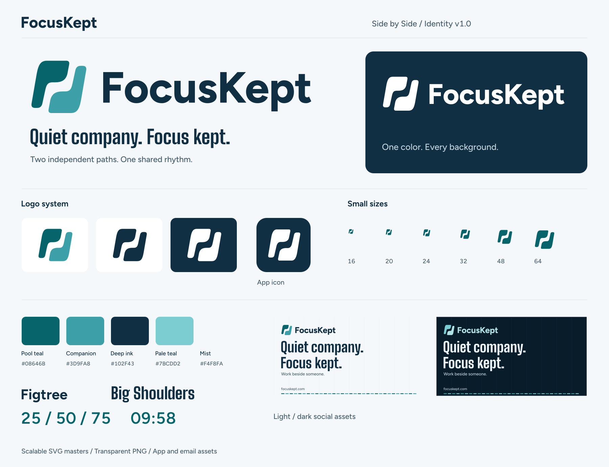

# FocusKept / Side by Side

Direction A was selected by the owner with the message **“a”** on 23 November 2026. This is the first engineered vector kit derived from that selected direction. On 24 November 2026 the owner handed over the integration prompt, which approves this artwork for local integration; the app now uses it. The manifest records the direction selection and that approval separately.



## Start here

| Need                           | Location                                                                   |
| ------------------------------ | -------------------------------------------------------------------------- |
| Identity preview               | [exports/preview.png](exports/preview.png)                                 |
| Six-page guidelines            | [exports/FocusKept-guidelines.pdf](exports/FocusKept-guidelines.pdf)       |
| Primary horizontal SVG         | [source/horizontal-primary.svg](source/horizontal-primary.svg)             |
| White horizontal SVG           | [source/horizontal-white.svg](source/horizontal-white.svg)                 |
| Primary symbol SVG             | [source/symbol-primary.svg](source/symbol-primary.svg)                     |
| One-color symbol SVG           | [source/symbol-ink.svg](source/symbol-ink.svg)                             |
| All assets and exact checksums | [manifest.json](manifest.json)                                             |
| Color/type/shape/motion tokens | [tokens.json](tokens.json)                                                 |
| Usage and licensing            | [../docs/brand/usage.md](../docs/brand/usage.md)                           |
| Application handoff            | [../docs/brand/integration-prompt.md](../docs/brand/integration-prompt.md) |

The complete gallery is also available as [index.html](index.html). Open it locally to switch logo variants and browse exports. It is a standalone artifact; it is not an application route.

## File structure

- `source/`: editable geometry JSON and generated outlined SVG masters.
- `templates/`: self-contained SVG compositions, with all text outlined. Change the generator and original copy to edit text; do not try to retype outlined text in an image editor.
- `fonts/`: original upstream variable TTF files, original OFL notices, and provenance.
- `exports/`: transparent PNG logos, vector PDFs, social/repository assets, renderer-ready static fonts, literal token exports, and guidelines.
- `../public/brand/`: the runtime subset the app serves: header/manifest/notification icons, email logos, and logo SVGs for download.

## Reproduce

Use the repository's Node 24 / pnpm environment. Normal app development needs no extra tools. Brand generation additionally requires HarfBuzz CLI (`hb-vector`, `hb-subset`, `hb-shape`), Python 3 standard library, and Cairo for vector PDF output. On macOS these are the `harfbuzz` and `cairo` Homebrew packages; on Debian/Ubuntu use the equivalent HarfBuzz utilities and Cairo runtime. The scripts use the Sharp version already pinned transitively by Next.js; no new npm dependency or lockfile change is required.

```sh
pnpm brand:generate
pnpm brand:check
pnpm brand:export --size 2048 --variant primary --output brand/custom/symbol-2048.png
```

The arbitrary export command supports square symbol PNGs from 16 to 8192 pixels in `primary`, `dark`, `ink`, `white`, or `teal`. It writes only the specified repository-local destination and does not modify the kit manifest. Keep ad hoc exports in `brand/custom/` unless intentionally adding them to the reproducible inventory.

The generator never changes application code, CSS, or deployment credentials. Icon exports with a `targetPath` (`public/favicon.ico`, `public/icon.svg`, `public/apple-touch-icon.png`) are copied to those conventional URLs on each generation once the manifest says `integrated`, and `pnpm brand:check` fails if a copy drifts. The app reads geometry and colors from `exports/code/` (through `src/config/brand-assets.ts`) and the OG/share renderers read `exports/fonts/`, so regenerating updates the UI without hand edits.

Generation preserves an existing explicit artwork approval only when all inventoried source digests still match. Editing a creative source or generator returns the new output to draft, so an old approval cannot silently authorize new artwork. Do not use generation to manufacture an approval record.

Original artwork follows the repository's AGPL-3.0-only license. Font software remains OFL-1.1 with its original notices. No additional trademark restrictions or trademark-clearance claim are imposed by this kit.
